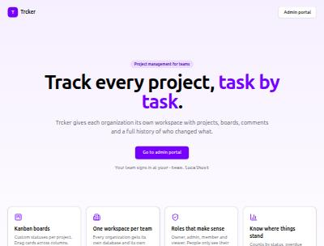
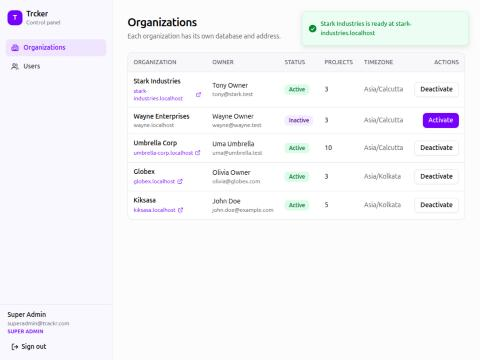
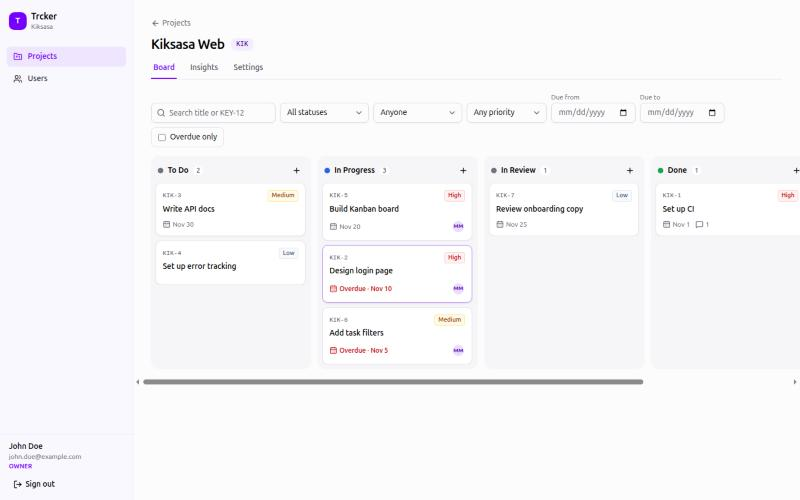
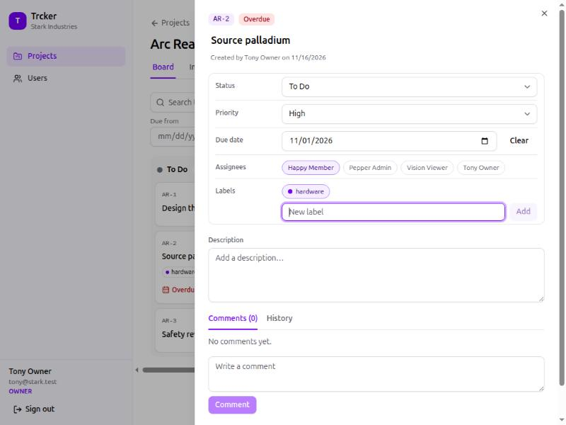
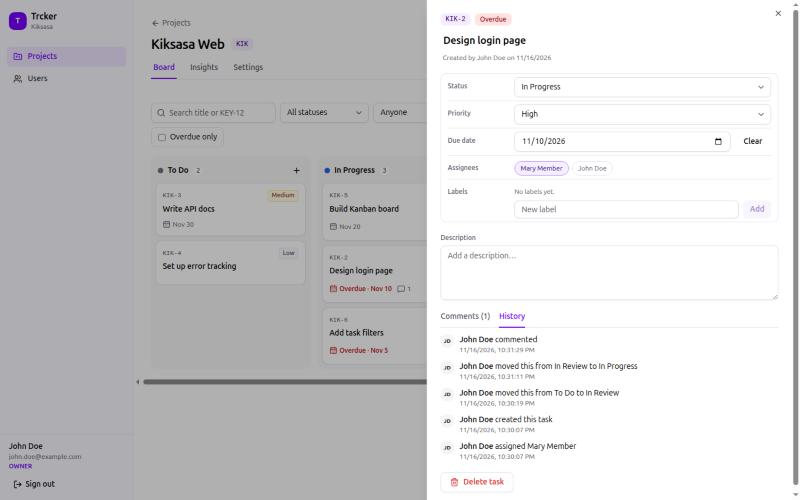
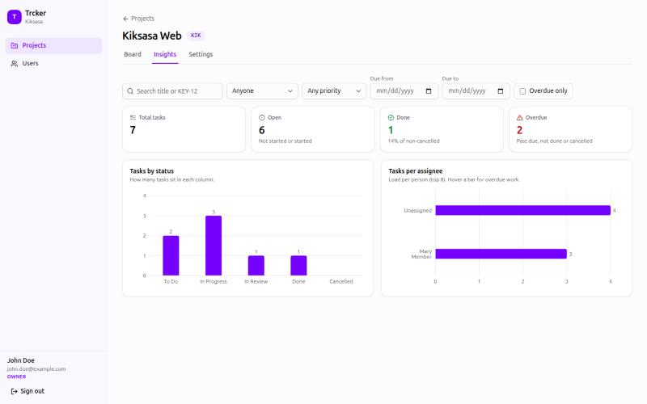

# End-to-end browser run (D13)

**Date:** 2026-11-16
**Browser:** Claude's built-in browser. chrome-devtools-mcp was not connected in this session.
**Modes tested:**

- Docker: Nginx on `:5173`.
- No Docker: `npm run dev`, with Vite on `:5173` and the API on `:4000`.

**Automated tests at the end:** 93 API and 53 web, all passing.

## Journey (Docker)

| #   | Step                                                                                              | Result                                                                                            |
| --- | ------------------------------------------------------------------------------------------------- | ------------------------------------------------------------------------------------------------- |
| 1   | Super admin signs out, then signs back in at `admin.localhost:5173`                               | ✅                                                                                                |
| 2   | Creates owner **Tony Owner** (`tony@stark.test`)                                                  | ✅                                                                                                |
| 3   | Creates org **Stark Industries**: slug `stark-industries` (filled from the name), project limit 3 | ✅ Active after about 2s. DB `tenant_stark_industries_db` owned by `tenant_stark_industries_user` |
| 4   | Tony signs in at `stark-industries.localhost:5173` with the default owner password                | ✅ Token stored as `trcker:stark-industries:token`                                                |
| 5   | Tony adds Pepper (admin), Happy (member) and Vision (viewer)                                      | ✅ Roles correct                                                                                  |
| 6   | Tony creates project **Arc Reactor** with all three as members. Short code `AR` is suggested      | ✅ 4 default statuses                                                                             |
| 7   | Adds status **QA**, then drags it between In Progress and Done                                    | ✅ Order kept after reload                                                                        |
| 8   | Adds AR-1, AR-2, AR-3 with column quick add                                                       | ✅                                                                                                |
| 9   | Task drawer: priority High, due date 2026-11-01, assigns Happy, creates the label "hardware"      | ✅ Card shows Overdue, label and assignee                                                         |
| 10  | Tony comments, then drags AR-2 from To Do into an empty In Progress column                        | ✅                                                                                                |
| 11  | Filter "Overdue only"                                                                             | ✅ Only AR-2                                                                                      |
| 12  | Happy (member) sees only Arc Reactor and no "New project"                                         | ✅                                                                                                |
| 13  | Happy replies to Tony's comment and moves AR-2 to QA from the drawer                              | ✅                                                                                                |
| 14  | History shows all 9 changes in plain words, newest first                                          | ✅                                                                                                |
| 15  | Happy's project settings are read-only (no editable fields, no drag handles)                      | ✅                                                                                                |
| 16  | Vision (viewer): no drag, no add, no comment box, read-only drawer, but sees the thread           | ✅                                                                                                |
| 17  | Vision calls `moveTask` directly with their token                                                 | ✅ `FORBIDDEN` from the API                                                                       |
| 18  | Tony's token on `kiksasa` (REST and GraphQL)                                                      | ✅ 401                                                                                            |
| 19  | `X-Tenant-Slug: stark-industries` sent to the root host                                           | ✅ Ignored, "Workspace not found"                                                                 |
| 20  | Direct call to API port 4000                                                                      | ✅ Not reachable in Docker                                                                        |
| 21  | Super admin deactivates Stark                                                                     | ✅ The tenant page is a 404 right away, and API login returns `TENANT_NOT_FOUND`                  |
| 22  | Unknown slug `wakanda.localhost:5173` and unknown host                                            | ✅ 404                                                                                            |
| 23  | Reactivate Stark                                                                                  | ✅                                                                                                |

## Journey (no Docker, `npm run dev`)

| Step                                                         | Result                                                  |
| ------------------------------------------------------------ | ------------------------------------------------------- |
| Marketing, control panel (still signed in) and the org list  | ✅                                                      |
| `wakanda.localhost:5173`                                     | ✅ The app's own 404 page (Nginx isn't involved in dev) |
| Sign out, sign in as Happy, drag AR-1 to In Progress, reload | ✅ Saved                                                |
| Direct `:4000` call with a spoofed slug                      | ✅ 403 "Direct access not allowed" (no proxy secret)    |
| Spoofed slug sent through the Vite proxy from the root host  | ✅ Ignored                                              |

## Bugs found during D12–D13 and fixed

| Bug                                                                                        | Fix                                                                                                                          |
| ------------------------------------------------------------------------------------------ | ---------------------------------------------------------------------------------------------------------------------------- |
| Every GraphQL call returned 415 in a real browser                                          | The token code dropped `Content-Type`. It now copies headers properly, with a test through the real client                   |
| A card dropped on one column landed in the next one                                        | The drop target is now what's under the pointer: a card first, then its column                                               |
| A malformed ID in a URL filter (`?assignee=garbage`) or path gave a 500 "Unexpected error" | The API returns `BAD_USER_INPUT` / 400 "Invalid ID" (Prisma P2023), and the board ignores malformed IDs and dates in the URL |
| Status names squashed on laptop-width settings                                             | The two-column layout now starts only on wide screens, and the name field has a minimum width                                |

## Known gaps (not bugs, noted for later)

- Viewers can be picked as assignees. The API allows it, since they are project members.
- Opening the drawer right after quick add can hit the card below, because the layout shifts when the quick-add box closes.
- History entries written in the same transaction share a timestamp, so their order among themselves isn't guaranteed.

## Screenshots

|                                     |                                                  |
| ----------------------------------- | ------------------------------------------------ |
|   |  |
|           |            |
|  |                  |
