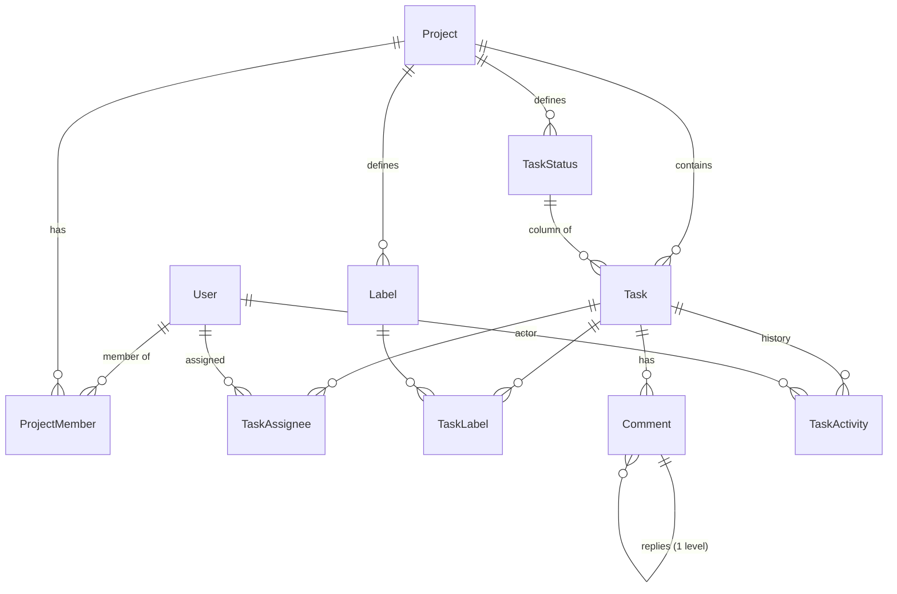

# Trcker — Technical Design

This doc explains how Trcker stores data, how the main screens query it, how tenants are kept apart, and how we change the schema safely.

Source of truth:

- `prisma/control.prisma`: the control plane
- `prisma/tenant.prisma`: one copy for each tenant
- `apps/api/src/graphql/schema/*.graphql`: the API

---

## 1. Data model

### Two kinds of database

| Database           | Holds                                                                                   | Why separate                                                                      |
| ------------------ | --------------------------------------------------------------------------------------- | --------------------------------------------------------------------------------- |
| `control_panel_db` | Super admin, org owners, organizations (slug, DB name, status, timezone, project limit) | Global data only. Small, read often, cached in Redis.                             |
| `tenant_<slug>_db` | Everything inside one organization: users, projects, tasks, comments, history           | Each org's data lives in its own database, so no query can leak data across orgs. |

### Tenant entities



The key decisions, and why:

- **Role is on the user**: one of `OWNER`, `ADMIN`, `MEMBER` or `VIEWER`. Each tenant DB is one org, so a user has one role. Which projects a user can see comes from `ProjectMember` rows.
- **Statuses are per project, each with a fixed category**: `NOT_STARTED`, `STARTED`, `COMPLETED` or `CANCELLED`. Teams can name columns anything they like ("In Review", "QA"). Charts and overdue logic only look at the category.
- **Overdue is worked out, not stored.** A task is overdue when its due date is before _today in the org's timezone_ and its category is not `COMPLETED` or `CANCELLED`. If overdue were a status, tasks would have to change status at midnight. That would mean a background job and fake history entries.
- **Order uses fractional numbers.**
  - New statuses get `position` 100, 200, 300. New tasks get `rank` 1000, 2000.
  - Dropping an item between two others gives it the midpoint (e.g. 1500), so only one row is updated.
  - When the gap between neighbours gets too small, we renumber that column.
- **Task keys like `KIK-12`.** `Project.taskSeq` counts upward. Creating a task bumps it in the same transaction, so two people never get the same number.
- **Many-to-many uses join tables.** `TaskAssignee` and `TaskLabel` have composite primary keys, which makes duplicate assignments impossible.
- **Comments are one level deep.** A reply has a `parentId`. The API rejects a reply to a reply.
- **History is append-only.** Every change writes a `TaskActivity` row (who, what field, old value, new value, when) _in the same transaction_ as the change. The history can't drift from the data.
- **Soft delete with the actor recorded.**
  - Tasks, labels and comments store `deletedAt` and `deletedById`. Projects store `archivedAt` and `archivedById`.
  - Rows stay, so we can audit and later restore them.
  - Every read filters on `deletedAt IS NULL`.

---

## 2. Query patterns

> SQL here uses snake_case column names to keep it easy to read. In Postgres, table names are snake_case (`tasks`, `task_assignees`), but column names match the Prisma fields and need quotes (`"statusId"`, `"deletedAt"`).

Every GraphQL request runs against one tenant DB, so tenant IDs never appear in queries. Visibility is enforced by the resolvers. The owner sees every project. Everyone else sees only projects where they have a `ProjectMember` row.

### a) "My overdue tasks across projects"

```graphql
query {
  myTasks(filter: { overdue: true }, first: 50) {
    edges {
      node {
        key
        title
        dueDate
        project {
          title
        }
        status {
          name
        }
      }
    }
    pageInfo {
      hasNextPage
      endCursor
    }
  }
}
```

```sql
SELECT t.* FROM tasks t
JOIN task_assignees a ON a.task_id = t.id AND a.user_id = $me
JOIN task_statuses s  ON s.id = t.status_id
JOIN project_members m ON m.project_id = t.project_id AND m.user_id = $me  -- skipped for OWNER
WHERE t.deleted_at IS NULL
  AND t.due_date < (now() AT TIME ZONE $orgTz)::date
  AND s.category NOT IN ('COMPLETED','CANCELLED')
ORDER BY t.rank, t.id   -- same (rank, id) cursor as the board
LIMIT 51;
```

The query starts from `task_assignees(user_id, task_id)`. A user has far fewer assignments than the project has tasks, so this is fast.

### b) One board column, page by page

The board loads each status column on its own. It fetches 50 tasks at a time and loads more on scroll.

```graphql
query Column($p: ID!, $s: ID!, $after: String) {
  tasks(projectId: $p, filter: { statusIds: [$s] }, first: 50, after: $after) {
    edges {
      cursor
      node {
        id
        key
        title
        priority
        assignees {
          name
        }
        labels {
          name
        }
      }
    }
    pageInfo {
      hasNextPage
      endCursor
    }
    totalCount
  }
}
```

```sql
SELECT * FROM tasks
WHERE status_id = $s AND deleted_at IS NULL
  AND (rank, id) > ($cursorRank, $cursorId)   -- from the decoded cursor
ORDER BY rank, id
LIMIT 51;   -- one extra row tells us hasNextPage
```

- **The cursor** is `base64("rank:id")`. The `id` breaks ties when two tasks share a rank.
- **No `OFFSET`.** Page 100 costs the same as page 1, and inserts don't shift pages.
- **Filters** for assignee, priority, labels and due date add `WHERE` clauses. The assignee and label filters use `EXISTS (...)`.

### c) Board summary and chart

`projectSummary(projectId)` runs three small grouped queries:

```sql
-- by status (the chart also rolls this up by category)
SELECT status_id, count(*) FROM tasks
WHERE project_id = $p AND deleted_at IS NULL GROUP BY status_id;

-- overdue
SELECT count(*) FROM tasks t JOIN task_statuses s ON s.id = t.status_id
WHERE t.project_id = $p AND t.deleted_at IS NULL
  AND t.due_date < (now() AT TIME ZONE $orgTz)::date
  AND s.category NOT IN ('COMPLETED','CANCELLED');

-- per assignee (a LEFT JOIN gives an "unassigned" bucket)
SELECT a.user_id, count(*) FROM tasks t LEFT JOIN task_assignees a ON a.task_id = t.id
WHERE t.project_id = $p AND t.deleted_at IS NULL GROUP BY a.user_id;
```

### d) Task details: comments and history

```graphql
query {
  task(id: $id) {
    title
    status {
      name
    }
    comments {
      body
      author {
        name
      }
      replies {
        body
        author {
          name
        }
      }
    }
    activity {
      type
      field
      fromValue
      toValue
      actor {
        name
      }
      createdAt
    }
  }
}
```

**Avoiding N+1 queries.** Fields like `author`, `assignees`, `labels`, `replies` and `status` go through **DataLoaders**, which are created fresh for each request.

- Fifty cards each asking for their assignees become one `WHERE task_id IN (...)` query, not fifty queries.
- Users and statuses are batched the same way.

### e) Moving a card (drag and drop)

`moveTask(id, statusId, afterTaskId, beforeTaskId)` does the following in one transaction:

1. Reads the ranks of the two neighbouring tasks.
2. Sets `rank = (after + before) / 2`, or ±1000 at either end of the column.
3. Updates `statusId`.
4. Sets or clears `completedAt` when the task enters or leaves a `COMPLETED` status.
5. Writes a `STATUS_CHANGED` history row.

---

## 3. Indexes

| Index                                                                 | Used by                                                                   |
| --------------------------------------------------------------------- | ------------------------------------------------------------------------- |
| `tasks(status_id, rank, id)`                                          | Board column pages: `WHERE status_id = ? ORDER BY rank, id` with a cursor |
| `tasks(project_id, rank, id)`                                         | Project-wide task list pages                                              |
| `tasks(project_id, status_id)`                                        | Status filter and count by status                                         |
| `tasks(project_id, due_date)`                                         | Due date range filter and the overdue count for a project                 |
| `tasks(due_date)`                                                     | Overdue across projects                                                   |
| `tasks(project_id, number)` (unique)                                  | Looking up `KIK-12`, and stopping duplicate numbers                       |
| `task_assignees(user_id, task_id)`                                    | "Assigned to me" and the assignee filter                                  |
| `task_labels(label_id)`                                               | Label filter                                                              |
| `project_members(user_id)`                                            | "Which projects can I see?"                                               |
| `task_statuses(project_id, position)`                                 | Columns in order                                                          |
| `comments(task_id, created_at)` and `comments(parent_id, created_at)` | Comment thread and replies                                                |
| `task_activities(task_id, created_at)`                                | Task history, newest first                                                |

Performance notes:

- **Index column order matches the query.** It is equality columns first (`status_id`), then the sort columns (`rank, id`). Postgres can then read rows already in order and stop after 51.
- **Soft-deleted rows stay in the indexes.** That is fine while they are few. If they grow, we add partial indexes (`WHERE deleted_at IS NULL`) in raw SQL migrations, because Prisma 6 can't express them.
- **Pool size per tenant.** Each tenant's Prisma client has `connection_limit=5`, and an LRU cache holds the active clients. Ten active tenants use at most 50 connections.

---

## 4. Keeping tenants apart

```
Browser ─► Nginx ─► API (Express)
           │         ├─ 1. tenant check   X-Tenant-Slug → Redis (60s) → control DB
           │         ├─ 2. rate limit     Redis token bucket for each tenant
           │         ├─ 3. DB client      LRU cache of PrismaClient for each tenant
           │         ├─ 4. auth           JWT must be for this tenant
           │         └─ 5. GraphQL / REST runs on this tenant's DB only
           └─ strips any client X-Tenant-Slug, sets it from the Host subdomain
```

There are five layers:

1. **Separate database for each tenant.** A tenant's queries go to its own DB. A bug in a `WHERE` clause can't return another org's rows.
2. **Separate DB login for each tenant.**
   - At provisioning we create a Postgres role that owns only `tenant_<slug>_db`. Its password is stored encrypted (AES-256-GCM) in the control DB.
   - Even a leaked tenant connection string can't open another tenant's DB.
3. **The slug comes from Nginx, not the browser.** Nginx deletes any `X-Tenant-Slug` the client sends and sets it from the subdomain. Unknown or inactive slugs get a 404 page.
4. **Tokens are tied to a tenant.**
   - The JWT holds `aud = "tenant:<slug>"`. A token from `acme` is rejected on `kiksasa`.
   - The JWT also holds a `tokenVersion`. Deactivating a user or changing their role bumps it, which ends their old sessions.
   - The control panel uses `aud = "admin"`.
5. **Fair use.** Each tenant has its own token bucket in Redis, so one busy tenant can't starve the rest. Limits come from env.

**In the browser**, localStorage keys are prefixed with the slug (`trcker:kiksasa:...`). You can be logged into two orgs in two tabs.

**Provisioning** creates a tenant in this order:

1. Create the org row as `PROVISIONING`.
2. Create the Postgres role and the database.
3. Apply the tenant migrations.
4. Seed the owner with a hashed default password.
5. Set the org to `ACTIVE`.

If any step fails, the org is set to `FAILED` and the error is saved.

---

## 5. Changing the schema

- **Control DB.** This is normal `prisma migrate`. Migrations live in `prisma/migrations/control/` and are applied on deploy.
- **Tenant DBs.**
  - Migrations live in `prisma/migrations/tenant/`, and the same folder is applied to _every_ tenant DB.
  - `npm run db:migrate:tenants` loops over all organizations and runs `prisma migrate deploy` against each one.
  - Prisma's `_prisma_migrations` table in each DB records which migrations have run, so the loop is safe to re-run.
  - If one tenant fails, the runner logs it and moves on. It marks that tenant for a retry. The other tenants are not blocked.
  - New tenants get every migration at provisioning time.
- **Make changes in two steps (expand, then contract).** For a while, old and new code run against tenants on different versions, so every change has to work for both.
  1. _Expand._ Add new columns or tables. New columns are nullable or have a default. Deploy code that writes both the old and new shape.
  2. _Backfill_ in batches if needed.
  3. _Contract._ Once every tenant has migrated and no code reads the old shape, drop it in a later release.
- **Rules:**
  - Never rename a column in one step. Add the new one, copy the data, then drop the old one.
  - Build indexes on large tables with `CREATE INDEX CONCURRENTLY` in raw SQL migrations.
  - Test each migration on a copy of the largest tenant before rolling it out.
